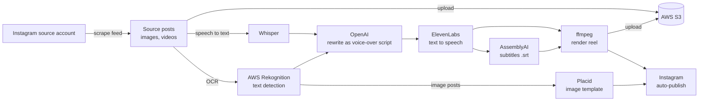

# ai-reels-pipeline

[](https://github.com/nicolasMazuryk/ai-reels-pipeline/actions/workflows/ci.yml)
[](LICENSE)

End-to-end AI short-video pipeline: source, transcribe (AssemblyAI), script (OpenAI), voice (ElevenLabs), render (ffmpeg) and auto-publish to Instagram.

## The problem

A faceless content account needs a steady stream of short vertical videos. Doing that by hand means finding material, writing a voice-over, recording it, subtitling it, editing it and posting it. This project automates every step, so one run turns a source account's posts into new, publish-ready reels.

## How it works



Each stage reads and writes JSON under `data/<source-account>/`, so stages can be re-run independently.

## Stack

- Node.js (CommonJS modules, run with `--env-file`)
- OpenAI (script writing, Whisper), ElevenLabs (voice), AssemblyAI (subtitles)
- AWS S3 and Rekognition, Placid (image templates)
- ffmpeg via `fluent-ffmpeg`, with an alternative `ffcreator` renderer
- `instagram-private-api` for publishing

## Getting started

Requirements: Node.js 20.6 or newer, and `ffmpeg` on your `PATH`.

```sh
npm ci
cp .env.example .env   # then fill in your own keys
npm run check          # syntax-checks every module
```

Choose the source account and the per-run limits in `config.cjs`. The stages that run are selected at the bottom of `index.cjs`: uncomment the ones you want, then start it.

```sh
npm run get-instagram-content
```

All credentials are read from the environment (see `.env.example`). `.env` is gitignored.

## Project layout

```
index.cjs                        orchestrates the stages
get-instagram-channel-posts.cjs  scrape the source account
detect-text-on-{image,video}.cjs OCR on source media
whisper.cjs                      speech to text
open-ai.cjs                      voice-over script
elevenlabs.cjs                   text to speech
assemblyai-transcribe.cjs        subtitles
fluent-ffmpeg.cjs                render (ffmpeg)
ffcreator-video.cjs              alternative renderer
generate-image-from-template.cjs image posts via Placid
publish-post-to-instagram.cjs    publish
s3.cjs, utils.cjs                helpers
```

## Design decisions

- **File-based stages.** Every stage persists JSON, so a failed run resumes from the last good file instead of paying for the API calls again.
- **Per-stage limits.** Constants in `config.cjs` cap how many items each stage handles, which keeps API cost predictable.
- **Swappable providers.** Subtitles can come from AssemblyAI or AWS Transcribe, and rendering from ffmpeg or ffcreator.

## Roadmap and limitations

- Stages are enabled by editing `index.cjs`; a proper CLI with sub-commands is the obvious next step.
- No automated tests; CI only syntax-checks the modules.
- Instagram access relies on a private API and a session cookie, so it can break without notice.
- Scraping and republishing other accounts' content has copyright and terms-of-service implications. Use your own sources.

## License

[MIT](LICENSE)
